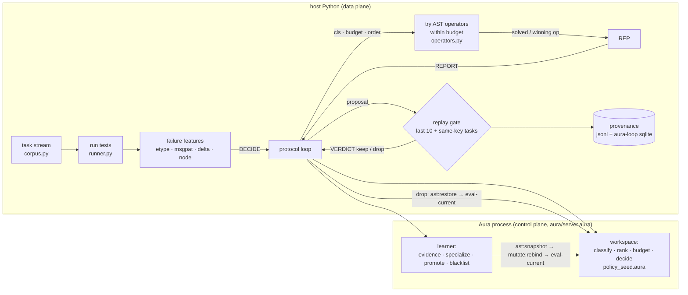

# aura-coder

A small coding agent whose **repair policy is live code in an Aura workspace**. The agent rewrites that
code itself (`mutate:rebind`) when it sees a new kind of failure, applies the change in place
(`eval-current`), checks it by replaying recent tasks, and keeps it or rolls it back
(`ast:snapshot` / `ast:restore`). Aura is the **control plane** only. Running tests and patching Python
(the **data plane**) happens in ordinary host Python.

This is "scenario 2" from the Aura agent-scenario list. The MVP asks one question: does letting an agent
edit its own fix strategy, while it runs and gated by tests, beat a fixed strategy when the kind of bug
changes over time? It also asks what that costs in latency and test runs.

## Motivation

The fix strategy of a coding agent covers three things: which failure goes in which class, which
repair to try first, and how many tries to allow. In most agents this lives in prompts or Python and
only changes when a person edits it and restarts the agent. In Aura the strategy is a set of workspace
`define`s:

- The agent can read the strategy back as source (`current-source :workspace`).
- It can rewrite one function (`mutate:rebind`) and make the change live without restarting (`eval-current`).
- It can take a snapshot and restore it (`ast:snapshot` / `ast:restore`).
- Every version is a readable source diff with a reason and a test verdict attached, recorded as provenance.

## Architecture



How one task runs:

1. Host runs the tests and gets failure features.
2. `DECIDE` calls the workspace `decide`, which returns a class, a budget and an operator order.
3. Host tries the operators in that order.
4. In adaptive mode the host then sends `REPORT`. A failed task first gets a wider post-mortem search so the learner still gets evidence.
5. The learner may propose one of two changes:
   - **specialize:** add a `classify` clause for this failure signature, pointing to a new class whose `rank` puts the winning operator first.
   - **promote:** re-rank a class's operators by how often each one won.
6. If it proposes a change, it snapshots the workspace, rebinds the generated functions and runs `eval-current`.
7. The host replays the last 10 tasks plus earlier tasks with the same signature, under the old and the new decision. It keeps the change only if the new one solves at least as many tasks and either solves more or needs fewer attempts. Otherwise it sends `VERDICT drop`, Aura runs `ast:restore` and `eval-current`, and the proposal is blacklisted until its evidence count doubles.
8. On a drop, the host checks that the restored source matches the pre-change source exactly, byte for byte.

## Aura primitives vs a Python / LangGraph equivalent

| aura-coder needs | Aura | Python / LangGraph equivalent |
|---|---|---|
| strategy as inspectable code | workspace `define`s, `current-source :workspace` | functions in a module; prompt strings in graph state |
| change one rule at runtime | `mutate:rebind "rank" <lambda src> <reason>` | `setattr(module, "rank", eval(src))`, or `importlib.reload`, or editing a prompt in state. No structural record of the change |
| apply without restart | `eval-current` | rebuild or recompile the graph (`StateGraph.compile()`), or restart the worker |
| version + rollback | `ast:snapshot` / `ast:restore` | a checkpointer (`MemorySaver` / SQLite) snapshots graph **state**, not the code of the nodes. Code rollback means git or re-importing an old module |
| find what to change | `query :find "rank"` | `inspect.getsource` / `ast` on the module |
| audit of every version | source text of each version plus reason and gate verdict (provenance.jsonl, aura-loop sqlite) | write it yourself |

The real difference is that the policy, its edit history and its rollback all live in one runtime as
code. A LangGraph checkpointer can roll back what the agent *knows*, but not how it *decides*. The cost is
that Aura's runtime rebinding is still young; see the known issues below.

## Results

Setup:

- Corpus: 25 templates and 35 bug variants in 9 bug classes, with 12 AST repair operators.
- Stream: 60 tasks with distribution shift. Window 1 (tasks 1–20) has only the classes the seed policy knows (off-by-one, compare, arith). Window 2 (tasks 21–40) is 40% known and 60% new (None guard, empty guard, missing import). Window 3 (tasks 41–60) is 30% / 30% / 40%, where the last 40% are three more new classes (type cast, wrong return, swapped args).
- Seeds 0–4. Each seed renames identifiers so the stream is not a literal replay.

Command: `python3 -m aura_coder bench --seeds 0 1 2 3 4 --n 60`. Binary: Aura main `c8ad457c9` build-rel,
run in `ghcr.io/cybrid-systems/dev:v1.0.9` with `--memory=4g`.

Modes:

- **static:** seed policy, learning off.
- **restart:** a fresh Aura process with the seed policy for every task. This is the "restart the agent each task" baseline.
- **adaptive:** learner plus replay gate plus rollback.
- **adaptive-nogate:** learner, every proposal kept.

### Clean tests (noise = 0), `results/bench-v3.*`

| mode | solve rate mean (min–max) | window 1 / 2 / 3 | attempts / solved (task) | attempts / solved (incl. post-mortem + gate) | mutations / seed | KEEP / ROLLBACK per seed | restart ms / task | wall s |
|---|---|---|---|---|---|---|---|---|
| static | 94.0% (90–97) | 100 / 86 / 96 | 3.35 | 3.35 | 0 | 0 / 0 | – | 8 |
| restart | 94.0% (90–97) | 100 / 86 / 96 | 3.35 | 3.35 | 0 | 0 / 0 | 86 | 13 |
| adaptive | **98.0%** (97–98) | 100 / 94 / 100 | **2.45** | 5.23 | 10.4 | 6.2 / 4.2 | – | 14 |
| adaptive-nogate | **98.0%** (97–98) | 100 / 94 / 100 | **2.45** | 2.90 | 9.4 | 9.4 / 0 | – | 9 |

Totals over 5 seeds: adaptive had 31 KEEP and 21 ROLLBACK; nogate had 47 KEEP. Every rollback restored the
source exactly, which the host asserts on each drop.

### Mis-attributed fixes (noise = 0.3), `results/noise30.*`

Each reported winning operator is replaced by a random wrong one with probability 0.3. This stands in for
noisy or flaky tests that credit the wrong fix. Static and restart don't learn, so they are unchanged at 94.0%.

| mode | solve rate mean (min–max) | window 1 / 2 / 3 | attempts / solved (task) | attempts / solved (incl. learning) | KEEP / ROLLBACK per seed |
|---|---|---|---|---|---|
| static (unchanged) | 94.0% (90–97) | 100 / 86 / 96 | 3.35 | 3.35 | 0 / 0 |
| adaptive (gate) | **95.3%** (93–98) | 100 / 90 / **96** | **2.96** | 6.27 | 3.6 / 2.8 |
| adaptive-nogate | 94.0% (88–98) | 100 / 90 / 92 | 3.06 | 4.01 | 6.2 / 0 |

Per seed, gate vs nogate: seeds 0, 1, 3 and 4 are identical. Seed 2 is 95.0% vs 88.3%, and the gate also
does better in window 3 there (100% vs 80%).

### Closed-loop latency, `results/latency.txt`

All steps were measured inside one Aura process. Aura only exposes `current-time-ms`, so each step was
looped N=200 times and the mean taken.

| step | µs / op |
|---|---|
| `set-code` (seed policy) + `eval-current` | 5755 |
| `query :find "rank"` | 95 |
| `mutate:rebind "rank"` | 2545 |
| `eval-current` | 745 |
| `mutate:rebind` + `eval-current` | 9990 |
| `decide` (workspace call) | 94 |
| `ast:snapshot` | 9085 |
| `ast:restore` + `eval-current` | 22090 |
| **full cycle** set-code → query → rebind → eval-current → decide | **9105** |

Host round trip (Python ↔ Aura over pipes, `perf_counter`):

| request | n | p50 | p99 | first → last |
|---|---|---|---|---|
| DECIDE | 1000 | 1.81 ms | 2.55 ms | 2.04 → 1.67 ms |
| MUTATE (REPORT that proposes: snapshot + 1–3 rebinds + eval-current) | 40 | 223 ms | 464 ms | 58 → 464 ms |
| KEEP | 20 | 0.5 ms | 1.2 ms | |
| ROLLBACK (restore + eval-current) | 20 | 23.5 ms | 51.9 ms | 6.1 → 51.9 ms |
| restart-each-task (spawn + set-code seed + eval-current + snapshot) | | 90 ms | | |

### What this shows, and what it doesn't

- **Self-edited policy helps under distribution shift.**
  - Solve rate goes from 94.0% to 98.0%, and task attempts per solve from 3.35 to 2.45.
  - All of the gain is in windows 2 and 3, where new bug classes appear. Window 1 is 100% in every mode.
  - Restarting each task gives exactly the static result plus about 86–90 ms per task. Keeping one process (and its learned rules) is what makes the improvement possible.
- **The gate does not earn its cost on clean tests.**
  - It never blocks a useful change, so nogate solves the same tasks.
  - It costs about 2.3 extra test runs per solved task (5.23 vs 2.90).
- **With 30% mis-attributed fixes, the gate is mildly useful.**
  - Mean solve rate is +1.3 points and window 3 is 96% vs 92%, for about 2.3 more test runs per solve (6.27 vs 4.01). It rolls back 44% of proposals.
  - The whole difference comes from one seed out of five, so this is a **hint, not a significant result**.
  - Next step: more seeds, a noise sweep from 0.1 to 0.5, and a cheaper gate (sample the window, or only replay tasks whose decision changed, which is already done).
- **Latency.**
  - Deciding is cheap, about 94 µs inside Aura.
  - A host DECIDE costs about 1.8 ms, roughly 19x the in-process cost. This is aura#4585: every host-program call gets slower after one `set-code`.
  - A full rebind + eval cycle costs about 10 ms in process.
  - The host-side MUTATE grows from 58 ms to 464 ms over 40 proposals. The generated rule tables grow, and aura#4585 also adds cost. The cause has not been isolated, so long runs need watching.
  - Even so, MUTATE stays far below the cost of one LLM call, which is the cost a real agent pays per attempt.

### Honest caveats

- The data plane is a toy: deterministic AST operators on small single-function Python modules, not an LLM. `aura_coder/proposer.py` adds an optional OpenAI-compatible `llm_patch` operator behind the same interface, but it is **not used** in any number above.
- There are 5 seeds of 60 tasks each, with no confidence intervals. The 98.0% vs 94.0% gap is consistent across seeds: adaptive scores ≥ 96.7% on every seed, and static scores 90–96.7%.
- The learner only edits rule *tables* (`classify` clauses, `rank` order, `budget`). It does not write new operators.
- "Noise" means mis-attributed winning operators. It does not model flaky tests that fail a correct patch.
- Two Aura workarounds shape the policy code (see below). The workspace `decide` returns a preference list, and the host completes the order.
- **`AURA_SANDBOX=off`** is set everywhere (`scripts/*.sh`, `run.sh`). With the sandbox on, the Soft level still blocks the workspace mutation and source primitives this agent needs (cybrid-systems/aura#4575). This means the policy process runs **without Aura's capability sandbox**. Run it only on trusted input, in a container with a memory cap. The scripts use `--memory=4g` because a runaway rebind (#4583) otherwise eats the host.

## Known Aura issues (found by this repo)

| issue | symptom | workaround here | acceptance |
|---|---|---|---|
| cybrid-systems/aura#4583 | repeated `mutate:rebind` gets ~4x slower each time and OOMs (13 GB RSS) when the workspace also holds a self-recursive define | no self-recursive defines in the workspace policy | `acceptance/4583` (FAIL on c8ad457c9) |
| cybrid-systems/aura#4584 | a second call to a workspace define runs a *different* define when a sibling passes a procedure to `filter`/`map` | no `filter`/`map` in the workspace; host completes the order | `acceptance/4584` (FAIL) |
| cybrid-systems/aura#4585 | after one `set-code`, every host-program call is ~25–38x slower | none (shows up as host DECIDE ≈ 1.8 ms) | latency table |
| #4546 / #4552 (open upstream) | define dropped / non-tail `error` dropped | not on the policy's path | `acceptance/4546`, `4552` (FAIL) |
| #4547 / #4550 (fixed in c8ad457c9) | wrong dispatch / invalid closure after rebind | none needed now | `acceptance/4547`, `4550` (PASS) |

`python3 -m aura_coder acceptance` prints PASS/FAIL for each item against `$AURA_BIN`
(latest output: `results/acceptance.txt`). Once an issue is fixed upstream, its workaround should be removed.

## Run it

```bash
git clone --recursive https://github.com/cybrid-systems/aura-coder && cd aura-coder
export AURA_BIN=~/aura/build-rel/aura          # Aura build-rel binary (main >= c8ad457c9)
scripts/test.sh --docker                        # unit tests (control-plane tests need AURA_BIN)
scripts/bench.sh --docker --seeds 0 1 2 3 4 --n 60 --modes static restart adaptive adaptive-nogate
scripts/in-docker.sh 'python3 -m aura_coder bench --modes adaptive adaptive-nogate --noise 0.3 --out runs-noise30'
scripts/in-docker.sh 'python3 -m aura_coder latency --n 200'
```

Layout:

- `aura/server.aura`: the learner, rule compiler and protocol loop.
- `aura/policy_seed.aura`: the version-0 policy.
- `aura/closed_loop_bench.aura`: the in-process latency benchmark.
- `aura_coder/`: the host side (corpus, test runner and features, operators, Aura client, agent loop, benchmark).
- `acceptance/`: Aura regression checks.
- `results/`: committed benchmark outputs.
- `third_party/aura-loop`: submodule providing the provenance store.

License: Apache-2.0.
